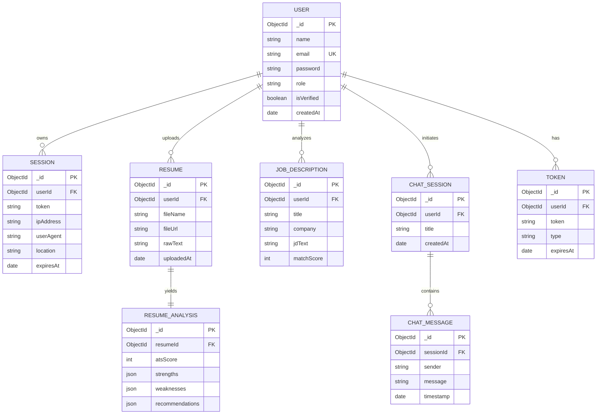

# ResumeSaathi Data Flow Diagram

## Level 0 Overview

```mermaid
flowchart TD
  classDef client fill:#1e3a8a,stroke:#3b82f6,stroke-width:3px,color:#ffffff
  classDef fe fill:#0369a1,stroke:#38bdf8,stroke-width:3px,color:#ffffff
  classDef be fill:#312e81,stroke:#818cf8,stroke-width:3px,color:#ffffff
  classDef db fill:#064e3b,stroke:#34d399,stroke-width:3px,color:#ffffff
  classDef ai fill:#701a75,stroke:#f472b6,stroke-width:3px,color:#ffffff
  classDef ext fill:#78350f,stroke:#f59e0b,stroke-width:3px,color:#ffffff
  classDef slab fill:#0f172a,stroke:#64748b,stroke-width:2px,color:#94a3b8

  subgraph Tier1[" "]
    Slab1[/ "👤 3D TIER 1 · CLIENT & PRESENTATION PLATFORM" \]:::slab
    U([ "Candidate / User Browser" ]):::client
    FE[[ "🎨 React 19 / Vite SPA Frontend" ]]:::fe
  end

  subgraph Tier2[" "]
    Slab2[/ "⚙️ 3D TIER 2 · APPLICATION ROUTER & SECURITY GATEWAY" \]:::slab
    API[[ "⚙️ Express.js REST API Ingress<br/>JWT Auth, Multer & Controllers" ]]:::be
  end

  subgraph Tier3[" "]
    Slab3[\ "💾 3D TIER 3 · PERSISTENCE & CLOUD SERVICES STACK" /]:::slab
    DB[( "🍃 MongoDB Atlas Multi-Tenant Clusters" )]::db
    AI[[ "🤖 Google Gemini 3.5 Flash Lite" ]]:::ai
    CL[( "☁️ Cloudinary PDF Storage Vault" )]::ext
    EM[[ "📧 SMTP Verification Mailer" ]]:::ext
    OAuth[[ "🔐 OAuth Providers (Google & LinkedIn)" ]]:::ext
    GEO[[ "🌍 GeoIP Services (ipify + ipapi)" ]]:::ext
  end

  U <==>|HTTPS / Interactive UI| FE
  FE <==>|JSON REST / Credentials / Cookies| API
  API <==> DB
  API <==> AI
  API <==> CL
  API ==> EM
  API <==> OAuth
  API <==> GEO

  style Tier1 fill:#0b132b,stroke:#1e40af,stroke-width:3px,color:#fff
  style Tier2 fill:#160f29,stroke:#4338ca,stroke-width:3px,color:#fff
  style Tier3 fill:#051b14,stroke:#059669,stroke-width:3px,color:#fff
```

## Level 1 Core Application Flows

```mermaid
flowchart TB
  classDef fe fill:#0284c7,stroke:#0369a1,stroke-width:2px,color:#ffffff,rx:8,ry:8
  classDef be fill:#4f46e5,stroke:#4338ca,stroke-width:2px,color:#ffffff,rx:8,ry:8
  classDef proc fill:#be185d,stroke:#fe3e91,stroke-width:2px,color:#ffffff,rx:8,ry:8
  classDef store fill:#059669,stroke:#047857,stroke-width:2px,color:#ffffff,rx:8,ry:8
  classDef cloud fill:#d97706,stroke:#b45309,stroke-width:2px,color:#ffffff,rx:8,ry:8

  subgraph Frontend["🎨 Tier 1 · Frontend UI Layer"]
    L["🏠 Landing Page"]:::fe
    A["🔐 Auth Pages<br/>Login / Signup / Verify"]:::fe
    D["📊 Dashboard Pages<br/>Resume / Job / Chat / Settings"]:::fe
    S[["⚡ API Client<br/>Axios + JWT Credentials + IP"]]:::fe
  end

  subgraph Backend["⚙️ Tier 2 · Express API Router & Security Gateway"]
    R1["Auth Routes<br/>/api/v1/users + /auth"]:::be
    R2["Resume Routes<br/>/api/v1/resumes"]:::be
    R3["Job Routes<br/>/api/v1/jobs"]:::be
    R4["Chat Routes<br/>/api/v1/chating"]:::be
    R5["Session & Profile Routes<br/>/users/me, /sessions"]:::be
    M{{"🛡️ JWT Verification Middleware"}}:::be
    P{{"🔑 Passport OAuth Handler"}}:::be
  end

  subgraph Processing["🧠 Tier 3 · Deep Business Intelligence Engine"]
    U1[["📄 PDF Text Parser<br/>Structure & Skill Extraction"]]:::proc
    U2[["🎯 Job Matcher<br/>Resume vs JD Analysis"]]:::proc
    U3[["🤖 Resume-Aware AI Assistant<br/>Gemini 3.5 Context Engine"]]:::proc
    U4[["📍 Session & Device Generator<br/>IP, Browser, OS & Geolocation"]]:::proc
  end

  subgraph Storage["💾 Tier 4 · Database Document Store"]
    M1[("👤 Users Collection")]:::store
    M2[("📱 Sessions Collection")]:::store
    M3[("📈 ResumeAnalysis")]:::store
    M4[("📁 ResumesCollection")]:::store
    M5[("💼 JobDescription")]:::store
    M6[("💬 ChatSession")]:::store
    M7[("✉️ ChatMessage")]:::store
    M8[("🔑 Verification Tokens")]:::store
  end

  subgraph External["☁️ Tier 5 · External Cloud Infrastructure"]
    G1[["🤖 Google Gemini 3.5 Flash Lite"]]:::cloud
    C1[["☁️ Cloudinary Storage CDN"]]:::cloud
    E1[["📧 SMTP Email Dispatcher"]]:::cloud
    O1[["🔐 Google OAuth 2.0"]]:::cloud
    O2[["💼 LinkedIn OAuth 2.0"]]:::cloud
    I1[["🌐 ipify Public IP Resolver"]]:::cloud
    I2[["📍 ipapi Location Service"]]:::cloud
  end

  L --> S
  A --> S
  D --> S

  S --> R1
  S --> R2
  S --> R3
  S --> R4
  S --> R5

  R1 --> M
  R2 --> M
  R3 --> M
  R4 --> M
  R5 --> M

  R1 --> P
  P --> O1
  P --> O2

  R1 --> U4
  U4 --> M1
  U4 --> M2
  U4 --> M8
  U4 --> I1
  U4 --> I2

  R2 --> U1
  U1 --> C1
  U1 --> G1
  U1 --> M4
  U1 --> M3
  U1 --> M1

  R3 --> U2
  U2 --> G1
  U2 --> M5

  R4 --> U3
  U3 --> G1
  U3 --> M6
  U3 --> M7
  U3 --> M4

  R1 --> E1
  R5 --> M1
  R5 --> M2
  R5 --> M5
  R5 --> M3
  R5 --> M6
  R5 --> M7

  M --> FE2[("📦 Response JSON / Secure Cookies")]:::store
  FE2 --> D
  FE2 --> A
```




## Database Schema & Entity Relationship Diagram (ERD)



---

## Main User Journeys

1. Landing and auth: the user opens the React frontend, signs up or logs in, and the backend creates a session cookie plus profile data.
2. Resume upload: the dashboard uploads a PDF resume, the backend parses it, stores the file and extracted data, sends it to Gemini for analysis, then saves the analysis in MongoDB.
3. Job description analysis: the user submits a JD, the backend compares it with the stored resume and saves the match results for later viewing.
4. Chat assistant: the user chats from the dashboard, and the backend combines the current message, prior chat history, and resume text to generate a resume-aware AI response.
5. Sessions and settings: the user can list or revoke sessions, change passwords, and manage account state through authenticated user routes.