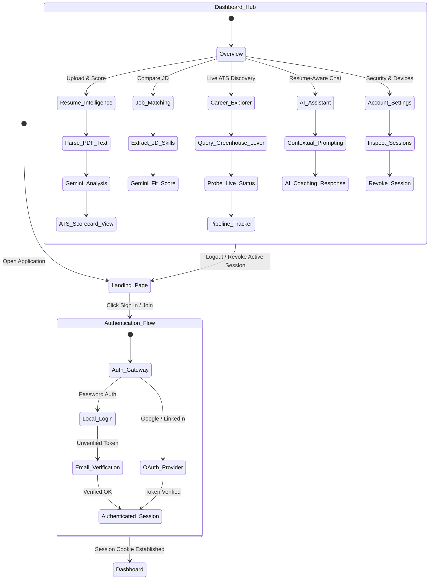

# ResumeSaathi User Flow Diagram

```mermaid
flowchart TD
  classDef start fill:#1e3a8a,stroke:#3b82f6,stroke-width:3px,color:#ffffff
  classDef view fill:#0369a1,stroke:#38bdf8,stroke-width:3px,color:#ffffff
  classDef decision fill:#78350f,stroke:#f59e0b,stroke-width:3px,color:#ffffff
  classDef action fill:#4338ca,stroke:#818cf8,stroke-width:3px,color:#ffffff
  classDef ai fill:#831843,stroke:#fe3e91,stroke-width:3px,color:#ffffff
  classDef store fill:#064e3b,stroke:#34d399,stroke-width:3px,color:#ffffff
  classDef slab fill:#0f172a,stroke:#64748b,stroke-width:2px,color:#94a3b8

  Start([ "🚀 Start Session" ]):::start
  Landing[[ "🏠 Landing Page Portal" ]]:::view
  AuthCheck{{ "🔐 Logged In?" }}:::decision

  subgraph AuthPhase[" "]
    SlabA[/ "🔑 3D PHASE 1 · AUTHENTICATION JOURNEY" \]:::slab
    AuthPages[[ "📄 Login / Signup / Reset Pages" ]]:::view
    VerifyAuth[[ "✅ Verify Email or OAuth (Google/LinkedIn)" ]]:::action
  end

  Dashboard[[ "📊 Unified Dashboard Workspace" ]]:::action

  subgraph ResumePhase[" "]
    SlabR[/ "📄 3D PHASE 2 · RESUME INTELLIGENCE WORKFLOW" \]:::slab
    R1[[ "Upload PDF Resume" ]]:::action
    R2[[ "⚡ PDF Text Extraction & Sanitization" ]]:::action
    R3[[ "🤖 Gemini AI ATS Scoring & Bullet Tips" ]]:::ai
    R4[( "📈 Save Analysis to MongoDB Vault" )]::store
  end

  subgraph JobPhase[" "]
    SlabJ[/ "💼 3D PHASE 3 · JOB DESCRIPTION MATCHING" \]:::slab
    J1[[ "Submit Target Job Description" ]]:::action
    J2[[ "🤖 AI Resume vs JD Comparison" ]]:::ai
    J3[[ "🎯 Compatibility Score & Missing Keywords" ]]:::view
  end

  subgraph CareerPhase[" "]
    SlabC[/ "🌐 3D PHASE 4 · LIVE ATS CAREER OPENINGS" \]:::slab
    C0[[ "Browse Curated Openings" ]]:::action
    C1[[ "🏢 Official ATS Direct Crawlers" ]]:::action
    C2{{ "🛡️ Live Requisition Verification Probe" }}:::ai
    C3[( "📋 Application Pipeline Tracker" )]::store
  end

  subgraph ChatPhase[" "]
    SlabCh[/ "💬 3D PHASE 5 · CONTEXT-AWARE AI CHAT" \]:::slab
    CH1[[ "Ask Career & Resume Questions" ]]:::action
    CH2[[ "🤖 Gemini Context-Aware Assistant" ]]:::ai
    CH3[[ "💡 Actionable Career Coaching Answers" ]]:::view
  end

  subgraph AccountPhase[" "]
    SlabAc[\ "⚙️ 3D PHASE 6 · SECURITY & SESSION CONTROLS" /]:::slab
    S1[[ "Manage Active Sessions & Devices" ]]:::action
    Logout([ "🚪 Logout Session" ]):::start
  end

  Start ==> Landing
  Landing ==> AuthCheck
  AuthCheck ==>|No| AuthPages
  AuthPages ==> VerifyAuth
  VerifyAuth ==> Dashboard
  AuthCheck ==>|Yes| Dashboard

  Dashboard ==> R1
  R1 ==> R2 ==> R3 ==> R4

  Dashboard ==> J1
  J1 ==> J2 ==> J3

  Dashboard ==> C0
  C0 ==> C1 ==> C2 ==> C3

  Dashboard ==> CH1
  CH1 ==> CH2 ==> CH3

  Dashboard ==> S1
  S1 ==> Logout
  Logout ==> Landing

  style AuthPhase fill:#0b132b,stroke:#1e40af,stroke-width:3px,color:#fff
  style ResumePhase fill:#22051e,stroke:#fe3e91,stroke-width:3px,color:#fff
  style JobPhase fill:#160f29,stroke:#7c3aed,stroke-width:3px,color:#fff
  style CareerPhase fill:#072b38,stroke:#0284c7,stroke-width:3px,color:#fff
  style ChatPhase fill:#1e1b4b,stroke:#6366f1,stroke-width:3px,color:#fff
  style AccountPhase fill:#051b14,stroke:#059669,stroke-width:3px,color:#fff
```


## Application State Machine & User Progression



---

## Summary

This diagram shows the main user journey from landing on the site to authentication, resume analysis, job matching, chat, settings, and logout.