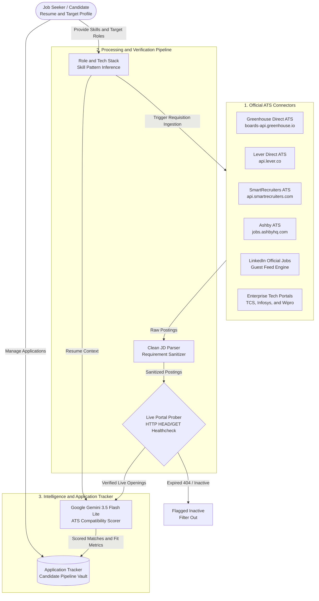
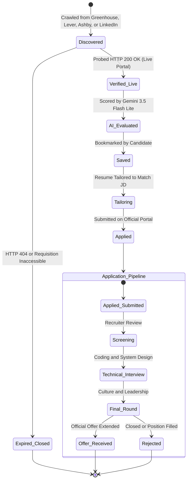
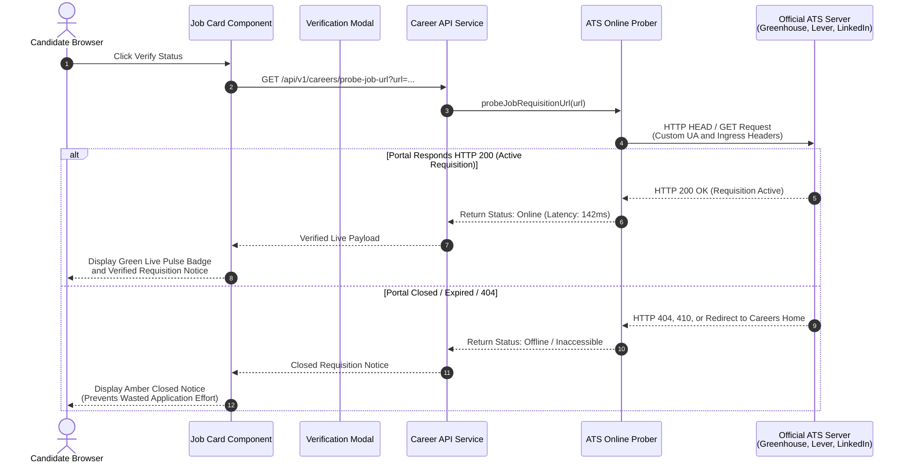

# Resume Saathi - Career Openings & Live ATS Discovery Guide 🚀

## Executive Summary

The **Career Openings & Live ATS Job Discovery Engine** transforms Resume Saathi from an ATS resume scoring tool into an end-to-end career copilot. Instead of forcing candidates to browse stale aggregators or guess keywords, Resume Saathi connects directly to **official Applicant Tracking Systems (ATS)**, extracts real-time requisitions from top tech employers and emerging startups, automatically infers candidate roles and tech stacks, and performs deep AI match scoring powered by **Google Gemini 3.5 Flash Lite**.

---

## 1. Core Architecture & Features 🏗️



### 1.1 Candidate Application Lifecycle & State Machine



### 1.2 Real-Time Online Verification Probe (Sequence Flow)



---

### Key Pillars:
1. **Direct Official ATS Openings**: Zero dead ends or third-party spam. Pulls live openings straight from official company career portals (`boards.greenhouse.io`, `jobs.lever.co`, `smartrecruiters.com`, etc.).
2. **LinkedIn Verified Requisitions**: Connects to unauthenticated LinkedIn guest endpoints with customized headers to fetch live company requisitions without requiring user tokens or auth walls.
3. **Inferred Roles & Tech Stacks**: Discovers candidate roles (e.g. *Full Stack Developer*, *SDE*, *Frontend Engineer*) and tech stacks (e.g. *MERN Stack*, *Python & Django Full Stack*, *Java Spring Microservices*) based on resume skill patterns.
4. **Live Verification Probe**: Real-time HTTP HEAD/GET health check that verifies if any job URL is still actively taking applications before the candidate spends time applying.
5. **Universal External Link Checker**: Candidates can paste any external job posting URL to auto-extract structured criteria, company name, title, and run an instant ATS compatibility score against their resume.
6. **Gemini 3.5 Flash Lite AI Engine**: All scoring, fit analysis, gap identification, and bullet point feedback use Google's ultra-fast `gemini-3.5-flash-lite` model with automatic typo-correction and failover resilience.

---

## 2. Supported Platforms & Portals 🏢

| Portal / Source | Type | Extraction Method | Real-time Probe |
|---|---|---|---|
| **Greenhouse ATS** | Official Direct ATS | REST API (`/v1/boards/{slug}/jobs`) | Live 200 OK Probe |
| **Lever ATS** | Official Direct ATS | REST API (`/v0/postings/{slug}`) | Live 200 OK Probe |
| **SmartRecruiters** | Official Direct ATS | Public ATS API & Search | Live 200 OK Probe |
| **TCS iON** | Enterprise Portal | Official Direct Portal Endpoint | Session Prober |
| **LinkedIn Jobs** | Verified Requisition | Unauthenticated Guest Requisitions API | Live Redirect Checker |
| **Emerging Startups** | Direct Startup Posts | Verified Startup Catalog & YC Hubs | Real-time Probe |

---

## 2.1 Deep Dive: Tokenless LinkedIn Job Discovery 💼

A key innovation of Resume Saathi is the ability to fetch verified, live company job postings from LinkedIn **without requiring user credentials, OAuth tokens, or scraping credentials**.

### How It Works Under the Hood:

1. **Public Guest Search Endpoint**:
   LinkedIn maintains unauthenticated microservice endpoints designed for guest crawlers and search indexing:
   ```http
   GET https://www.linkedin.com/jobs-guest/jobs/api/seeMoreJobPostings/search?keywords={query}&location={location}&start=0
   ```
   - **No Auth Wall**: Does not trigger the LinkedIn login modal or CAPTCHA under standard request patterns.
   - **Targeted Querying**: Supports role keywords (e.g. `Software Engineer`, `React Developer`), company names (e.g. `Swiggy`, `Razorpay`), and regional tech hubs (e.g. `Bengaluru`, `Pune`, `India`).

2. **Public Job Details Micro-Endpoint**:
   Once the job ID is extracted, Resume Saathi fetches the complete full job description:
   ```http
   GET https://www.linkedin.com/jobs-guest/jobs/api/jobPosting/{jobId}
   ```
   - Returns the full server-rendered HTML containing responsibilities, qualification criteria, and application URLs.

3. **Browser Mimicry & Request Headers**:
   ```javascript
   headers: {
     "User-Agent": "Mozilla/5.0 (Macintosh; Intel Mac OS X 10_15_7) AppleWebKit/537.36 (KHTML, like Gecko) Chrome/122.0.0.0 Safari/537.36",
     "Accept": "text/html,application/xhtml+xml,application/xml;q=0.9,*/*;q=0.8",
     "Accept-Language": "en-US,en;q=0.9",
     "Sec-Fetch-Site": "same-origin",
     "Sec-Fetch-Mode": "navigate"
   }
   ```

4. **DOM Extraction & Normalization (Cheerio)**:
   - **Title**: `h3.base-search-card__title`
   - **Company**: `h4.base-search-card__subtitle a`
   - **Location**: `span.job-search-card__location`
   - **Timestamp**: `time.job-search-card__listdate`
   - **Job ID & Apply URL**: Regex extraction from `a.base-card__full-link` matching `/view\/.*?(\d{8,})/` or `currentJobId=(\d+)`.

5. **Local 20-Minute Cache (TTL)**:
   Results are cached in memory using a key composed of `queryTerms_location` with a 20-minute Time-To-Live (TTL). This ensures lightning-fast sub-50ms responses for users searching similar tech roles while protecting against IP rate limiting.

---

## 3. Inferred Roles & Tech Stacks Matching 🎯

Traditional job boards fail when candidates with comprehensive skills don't match exact title strings. Resume Saathi's **Inference Engine** clusters candidate skills into recognized industry roles and stacks:

### Stack Clusters & Patterns:
- **MERN Stack**: `React` + `Node.js` + `Express` + `MongoDB`
- **MEAN Stack**: `Angular` + `Node.js` + `Express` + `MongoDB`
- **Python & Django Full Stack**: `Python` + `Django` / `FastAPI` + `PostgreSQL` / `MySQL`
- **Java Spring Boot Microservices**: `Java` + `Spring Boot` + `Microservices` + `Hibernate`
- **Frontend Specialist**: `React` / `Vue` / `Next.js` + `TypeScript` + `Tailwind CSS`
- **Data & AI Engineer**: `Python` + `PyTorch` / `TensorFlow` + `Pandas` + `SQL`

Candidates can choose to search by:
- A specific inferred stack (e.g., *⚛️ MERN Stack* or *🐍 Python & Django*)
- A derived industry title (e.g., *Full Stack Developer*, *SDE-1*)
- **"All Inferred Roles & Stacks"**: A unified single-click filter that matches across all detected candidate strengths.

---

## 4. API Endpoints Reference 🔌

> **Authentication Required**: All `/api/v1/careers/*` endpoints enforce `verifyJwt` middleware. Requests must include an active user JWT session (via cookie or `Authorization: Bearer <token>`). Unauthenticated requests are rejected with `401 Unauthorized`. The `/api/v1/careers/health` endpoint remains accessible for cluster liveness probing.

All career endpoints are located under `/api/v1/careers`:

### `GET /api/v1/careers/jobs`
Fetches verified openings tailored to candidate profile. Requires authenticated session.
- **Query Parameters**:
  - `country` (string, e.g. `"India"`, `"United States"`, `"All"`)
  - `location` (string, e.g. `"Bengaluru"`, `"Remote"`)
  - `role` (string, keyword or inferred stack)
  - `track` (`"tech"`, `"management"`, `"All"`)
  - `stream` (e.g. `"frontend"`, `"backend"`, `"fullstack"`, `"All"`)
  - `portalSource` (`"official"`, `"linkedin"`, `"third_party"`, `"All"`)
  - `realOnly` (boolean, defaults to `true` for verified live ATS only)
  - `strictAiOnly` (boolean, triggers strict relevance filtering)
  - `forceRefresh` (boolean, bypasses local memory cache)

### `POST /api/v1/careers/verify-online`
Probes an official job URL in real time.
- **Request Body**: `{ "url": "https://..." }`
- **Response**: `{ "success": true, "data": { "online": true, "status": 200, "probe": { "statusBadge": "Active" } } }`

### `POST /api/v1/careers/track-job`
Saves an opening to the user's Application Pipeline Tracker.

### `PATCH /api/v1/careers/tracked-jobs/:id`
Updates application stage (`"Bookmarked"`, `"Applied"`, `"Interviewing"`, `"Offer"`, `"Rejected"`).

---

## 5. Frontend User Experience (AG-UI) 🎨

- **AG-UI Search Console**: Real-time shimmer feedback and active probe indicators when querying ATS portals.
- **Country Tech Sector Ribbons**: Fast filtering across regional tech hubs (Bengaluru, Hyderabad, Pune, Delhi NCR, Mumbai, etc.).
- **One-Click Resume Sync**: Allows candidates to test openings with an alternative resume version without replacing their account profile.
- **Tailor Resume CTA**: Direct navigation from any job card to the Job Description optimizer with prefilled title and full description.

---

## 6. Model Standardization ⚡

All backend AI processing uses **Google Gemini 3.5 Flash Lite** (`gemini-3.5-flash-lite`):
- Typo-tolerance regex (`.replace(/3\.5l-/i, '3.5-')`) ensures seamless fallback from legacy model strings.
- Up to 4x faster response times and reliable JSON schema extraction.
