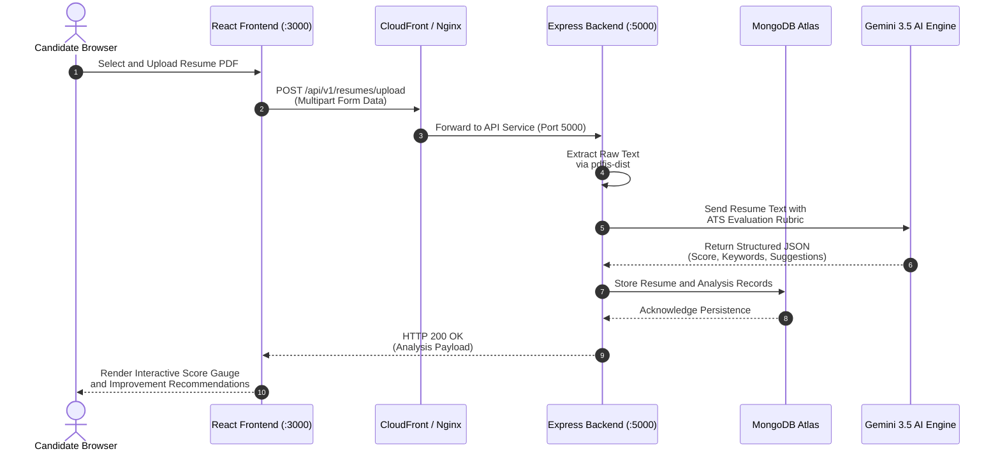

# Resume Saathi

Resume Saathi is an AI-powered ATS resume analysis and live job discovery platform.
It enables candidates to upload resumes, receive structured scoring and gap analyses,
discover live verified requisitions from official ATS portals (Greenhouse, Lever, SmartRecruiters, LinkedIn),
infer candidate roles and technology stacks, and perform deep match scoring against job descriptions
powered by Google Gemini 3.5 Flash Lite.

## Technology Stack

- Frontend: React, Vite, Redux Toolkit, Tailwind CSS
- Backend: Node.js, Express, MongoDB (Mongoose)
- AI Integration: Google GenAI SDK (Gemini 3.5 Flash Lite)
- Authentication: JWT, Google OAuth, LinkedIn OAuth
- File Services: Multer, Cloudinary
- Cloud & DevOps: AWS (CloudFront CDN, EC2, ACM), Docker, Nginx

## Architecture Flow

```mermaid
flowchart TD
  User(["Candidate Web Browser<br/>HTTPS Port 443"])
  CF["AWS CloudFront CDN<br/>Global Edge POPs and WAF"]
  Nginx["Host Nginx Reverse Proxy<br/>Port 443 SSL Termination"]
  FE["React 19 Vite Container<br/>Frontend SPA (:3000)"]
  BE["Node.js Express Container<br/>Backend REST API (:5000)"]
  DB[("MongoDB Atlas<br/>Managed Database Cluster")]
  AI["Google Gemini 3.5 Flash Lite<br/>ATS Scoring and Matching Engine"]
  Cloudinary[("Cloudinary Storage CDN<br/>PDF File Vault")]
  ATS["Live ATS Discovery Engine<br/>Greenhouse, Lever, and Ashby"]

  User -->|HTTPS Request| CF
  CF -->|Origin Cloaked Traffic| Nginx
  Nginx -->|Proxy Pass :3000| FE
  Nginx -->|Proxy Pass /api (:5000)| BE
  BE <-->|Mongoose ODM| DB
  BE <-->|GenAI SDK| AI
  BE <-->|Signed Uploads| Cloudinary
  BE <-->|Direct Ingestion| ATS
```

### End-to-End User & AI Analysis Flow (Sequence Diagram)



---

## Repository Structure

```
Resume-Saathi/
├── .github/
├── Backend/
├── Frontend/
├── Databases/
├── Testing/
├── README.md
├── CONTRIBUTING.md
├── CODE_OF_CONDUCT.md
├── SECURITY.md
├── SUPPORT.md
└── CHANGELOG.md
```

## Prerequisites

- Node.js 20 or later
- npm 10 or later
- MongoDB (local or cloud)

## Quick Start

### 1. Start the backend

```bash
cd Backend
npm install
copy .env.sample .env
npm start
```

Backend default URL: `http://localhost:5000`

### 2. Start the frontend

Create `Frontend/.env` with:

```env
VITE_SERVER_URL=http://localhost:5000/api/v1
```

Then run:

```bash
cd Frontend
npm install
npm run dev
```

Frontend default URL: `http://localhost:5173`

## Project Documentation

- Career Openings & ATS Discovery: [Docs/CAREER_OPENINGS_AND_ATS_FEATURE_GUIDE.md](file:///c:/Project/Resume-Saathi/Docs/CAREER_OPENINGS_AND_ATS_FEATURE_GUIDE.md)
- Career Openings Guide (DOCX): [Docs/Resume-Saathi_Career_Openings_and_ATS_Discovery_Guide.docx](file:///c:/Project/Resume-Saathi/Docs/Resume-Saathi_Career_Openings_and_ATS_Discovery_Guide.docx)
- Backend Guide: [Backend/README.md](file:///c:/Project/Resume-Saathi/Backend/README.md)
- Frontend Guide: [Frontend/README.md](file:///c:/Project/Resume-Saathi/Frontend/README.md)
- Deployment Guide: [Docs/DEPLOYMENT_GUIDE.md](file:///c:/Project/Resume-Saathi/Docs/DEPLOYMENT_GUIDE.md)
- AWS CloudFront & ACM Guide: [Docs/AWS_CLOUDFRONT_ACM_SETUP_GUIDE.md](file:///c:/Project/Resume-Saathi/Docs/AWS_CLOUDFRONT_ACM_SETUP_GUIDE.md)
- Contributing Guide: [CONTRIBUTING.md](file:///c:/Project/Resume-Saathi/CONTRIBUTING.md)
- Code of Conduct: [CODE_OF_CONDUCT.md](file:///c:/Project/Resume-Saathi/CODE_OF_CONDUCT.md)
- Security Policy: [SECURITY.md](file:///c:/Project/Resume-Saathi/SECURITY.md)
- Support Guide: [SUPPORT.md](file:///c:/Project/Resume-Saathi/SUPPORT.md)
- Changelog: [CHANGELOG.md](file:///c:/Project/Resume-Saathi/CHANGELOG.md)

## GitHub Templates

- Bug Report: [.github/ISSUE_TEMPLATE/bug_report.md](file:///c:/Project/Resume-Saathi/.github/ISSUE_TEMPLATE/bug_report.md)
- Feature Request: [.github/ISSUE_TEMPLATE/feature_request.md](file:///c:/Project/Resume-Saathi/.github/ISSUE_TEMPLATE/feature_request.md)
- Pull Request Template: [.github/pull_request_template.md](file:///c:/Project/Resume-Saathi/.github/pull_request_template.md)

## License

This project is licensed under the MIT License. See [LICENSE](file:///c:/Project/Resume-Saathi/LICENSE) for details.
