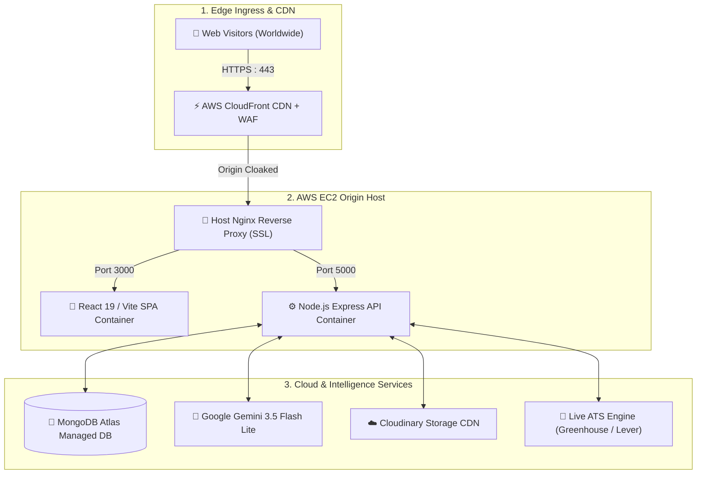
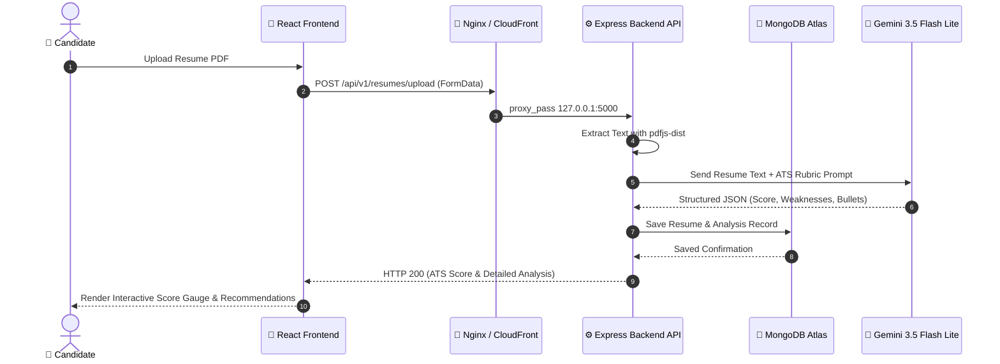

# Resume Saathi 🚀

Resume Saathi is an AI-powered ATS resume analysis and live job discovery platform. It helps users upload resumes, receive structured feedback, discover live verified requisitions from official ATS portals (Greenhouse, Lever, SmartRecruiters, LinkedIn), infer genuine industry roles and tech stacks, and match against job descriptions using Google Gemini 3.5 Flash Lite.

## Technology Stack ⚙️

- Frontend: React, Vite, Redux Toolkit, Tailwind CSS
- Backend: Node.js, Express, MongoDB (Mongoose)
- AI integration: Google GenAI SDK (Gemini 3.5 Flash Lite)
- Authentication: JWT, Google OAuth, LinkedIn OAuth
- File services: Multer, Cloudinary
- Cloud & DevOps: AWS (CloudFront CDN, EC2,  ACM), Docker, Nginx

## Architecture Flow 📐



### End-to-End User & AI Analysis Flow (Sequence Diagram)



---

## Repository Structure 🗂️

```
Resume-Saathi/
├── .github/
├── Backend/
├── Frontend/
├── Databases/
├── Testing/
├── README.md
├── CONTRIBUTING.md
├── CODE_OF_CONDUCT.md
├── SECURITY.md
├── SUPPORT.md
└── CHANGELOG.md
```

## Prerequisites ✅

- Node.js 20 or later
- npm 10 or later
- MongoDB (local or cloud)

## Quick Start 🚀

### 1. Start the backend

```bash
cd Backend
npm install
copy .env.sample .env
npm start
```

Backend default URL: http://localhost:5000 🌐

### 2. Start the frontend

Create Frontend/.env with:

```env
VITE_SERVER_URL=http://localhost:5000/api/v1
```

Then run:

```bash
cd Frontend
npm install
npm run dev
```

Frontend default URL: http://localhost:5173 🌐

## Project Documentation 📚

- Career Openings & ATS Discovery: [Docs/CAREER_OPENINGS_AND_ATS_FEATURE_GUIDE.md](file:///c:/Project/Resume-Saathi/Docs/CAREER_OPENINGS_AND_ATS_FEATURE_GUIDE.md)
- Career Openings Guide (DOCX): [Docs/Resume-Saathi_Career_Openings_and_ATS_Discovery_Guide.docx](file:///c:/Project/Resume-Saathi/Docs/Resume-Saathi_Career_Openings_and_ATS_Discovery_Guide.docx)
- Backend guide: Backend/README.md
- Frontend guide: Frontend/README.md
- Deployment guide: Docs/DEPLOYMENT_GUIDE.md
- AWS CloudFront & ACM guide: Docs/AWS_CLOUDFRONT_ACM_SETUP_GUIDE.md
- Contributing: CONTRIBUTING.md
- Code of Conduct: CODE_OF_CONDUCT.md
- Security policy: SECURITY.md
- Support: SUPPORT.md
- Changelog: CHANGELOG.md

## GitHub Templates 🧩

- Bug report: .github/ISSUE_TEMPLATE/bug_report.md
- Feature request: .github/ISSUE_TEMPLATE/feature_request.md
- Pull request: .github/pull_request_template.md

## License 📄

This project is licensed under the MIT License. See LICENSE for details.
